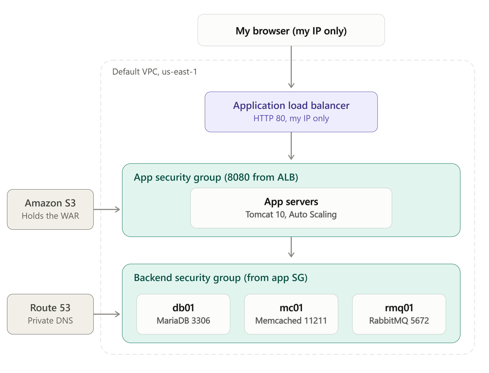
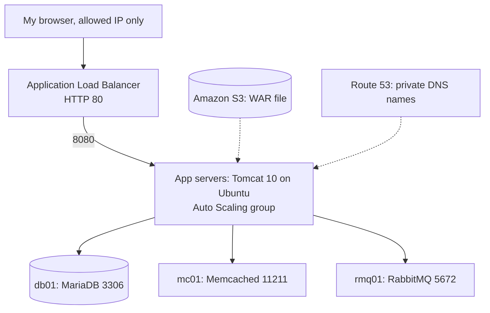

# vProfile Lift and Shift on AWS

I moved a multi-tier Java web application (vProfile) onto AWS using a lift and shift approach: the same application and services, rebuilt on EC2 instances, with a load balancer, private DNS, an artifact bucket and an Auto Scaling group around them.

I did not write the application. It is the open-source vProfile project used in my DevOps training. The work in this repo is the AWS deployment: networking, security groups, servers, load balancing, scaling and troubleshooting.

## Architecture

Everything runs in the default VPC in `us-east-1`.

| Component | What it does |
| --- | --- |
| Application Load Balancer | Receives HTTP on port 80 from my IP and forwards to the target group on port 8080. |
| Target group | HTTP on 8080, health check path `/login`, stickiness enabled so a user stays on one instance. |
| App server | Ubuntu with Java 17 and Tomcat 10, running the vProfile WAR as the root application. |
| db01 | Amazon Linux 2023 running MariaDB (port 3306) with the application database. |
| mc01 | Amazon Linux 2023 running Memcached (port 11211). |
| rmq01 | Amazon Linux 2023 running RabbitMQ (port 5672). |
| Amazon S3 | Stores the built WAR file. The app server downloads it using an IAM role, not stored keys. |
| Route 53 | A records in the `vprofile.in` zone point to the private IPs, so the app finds `db01`, `mc01` and `rmq01` by name. |
| Auto Scaling group | Launched from a launch template (`vprofile app`) built from an AMI of the configured app server. |

## Security groups

| Security group | Inbound rules |
| --- | --- |
| ALB SG | HTTP 80 from my public IP only |
| App SG | 8080 from the ALB SG, SSH 22 from my IP |
| Backend SG | 3306, 11211 and 5672 from the App SG, SSH 22 from my IP, and all TCP from the Backend SG itself so the backend servers can talk to each other |

The backend-to-backend rule is broader than the app strictly needs. I kept it for the lab. In a real environment I would remove it and open only the ports that are required.

While testing the app directly, I added a temporary rule for port 8080 from my IP. I removed it once the load balancer worked, so the app is only reachable through the ALB.

## How I deployed it

1. **Security groups first.** I created the three groups and referenced groups instead of IPs where possible, so rules survive instance changes.
2. **Backend servers.** I launched db01, mc01 and rmq01 on Amazon Linux 2023 with bootstrap scripts, then checked each service with `systemctl status` and `ss -tulpn`.
3. **Database.** I created the application database and imported the SQL backup, with a user that can connect from the app server.
4. **DNS.** I created A records in Route 53 for `db01`, `mc01` and `rmq01` pointing to their private IPs, so the application properties resolve inside the VPC.
5. **App server.** I launched an Ubuntu instance, installed Java 17 and Tomcat 10, and attached an IAM role that can read the artifact bucket.
6. **Build and upload.** I built the WAR with Maven (`mvn clean package`) and uploaded it to S3 with `aws s3 cp`.
7. **Deploy.** On the app server I downloaded the WAR, replaced the default root application with `ROOT.war`, and started Tomcat. I tested it with `curl -I localhost:8080`.
8. **Load balancer.** I created the target group (8080, health check `/login`, stickiness on) and the ALB on port 80 with its own security group.
9. **Scaling.** I created an AMI from the working app server, made a launch template from it, and used that for the Auto Scaling group attached to the target group.

## Problems I ran into

| Problem | Cause | Fix |
| --- | --- | --- |
| SSH timed out | My public IP had changed, so the security group rule no longer matched | Updated the rule to my current IP |
| Browser could not reach the app on port 8080 | The app SG had no rule for 8080 from my IP, only from another security group | Added a temporary rule for testing, then removed it |
| `aws: command not found` on the app server | The Ubuntu image does not include the AWS CLI | Installed the AWS CLI |
| `aws cp` failed with an invalid choice error | The `s3` service name was missing | Ran `aws s3 cp` instead |
| `ROOT` folder missing after copying the WAR | Tomcat only unpacks a WAR while it is running | Started Tomcat and waited for it to deploy |
| Load balancer returned 503 | The target group had no healthy registered target | Checked registration, the health check path and the 8080 rule from the ALB SG |

## Verification checklist

Tick each box only after testing it.

- [x] All four EC2 instances are running and passing status checks
- [x] Route 53 records exist for `app01`, `db01`, `mc01` and `rmq01`
- [x] The WAR file is stored in S3
- [x] Tomcat serves the application (`HTTP 200` on port 8080) and the login page loads
- [ ] The app server can connect to db01, mc01 and rmq01 by name
- [ ] The target group shows the app server as healthy
- [ ] The ALB DNS name opens the site on port 80
- [ ] Target group stickiness is enabled
- [ ] The temporary 8080 rule from my IP is removed
- [ ] A replacement instance launched by the Auto Scaling group passes the health check

## Cleanup

AWS bills for load balancers and instances by the hour, so when I finish I delete the Auto Scaling group, load balancer and target group, the instances, the AMI and its snapshots, the S3 bucket and the Route 53 zone.

## What I learned

- How to design security groups for a three-tier application using group-to-group rules.
- How a load balancer health check decides whether traffic reaches an instance.
- Why private DNS names matter when an application is moved to new servers.
- How to find the cause of a failure by checking which layer it comes from: the network rule, the instance, the service or the application.
- Why I should not rely on public IPs, and why instance roles are safer than stored keys.

## Screenshots.md

find images: `docs/ec2-instances.png`, `docs/route53-records.png` and `docs/login-page.png`.